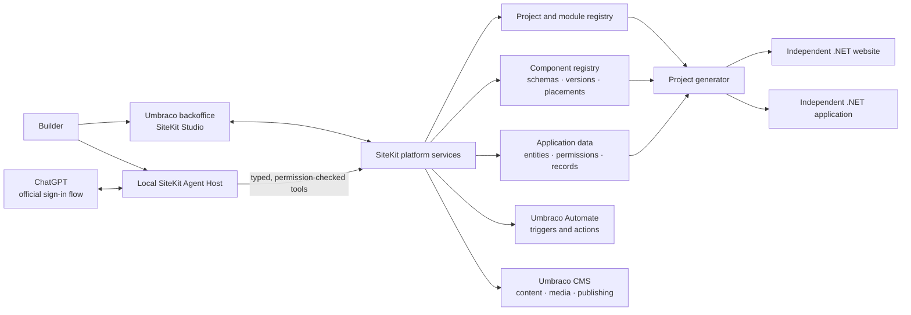

# SiteKit

[](https://github.com/stevenmcsorley/Umbraco-env/actions/workflows/sitekit-build.yml)


### Build websites and business applications on Umbraco. Keep the building blocks.

SiteKit is being developed as an open-source platform for creating **content-driven websites, internal business systems, and reusable software modules**. Compose validated components, model operational data, build application screens, install modules, and generate independently deployable .NET projects.

The platform grows with what you make: a component, entity, screen, or module can become a building block for the next project. Umbraco remains the CMS for editorial content; operational records live in application data stores suited to transactional work.

<p align="center">
  
</p>

<p align="center"><strong>From reusable component to a working application—with persistent records and permission-checked operations.</strong></p>

> **Project status:** SiteKit is under active development. The repository contains working platform capabilities and generated runtime evidence, alongside incomplete milestones. See the [implementation ledger](docs/SITEKIT_IMPLEMENTATION_PLAN.md) for exact status and verified results. The hotel and booking application remains in the repository as a working starter experience.

## What you can build

| Websites | Business applications | Reusable platform |
| --- | --- | --- |
| Marketing and corporate sites | CRMs and sales pipelines | Components and themes |
| Blogs, directories, event sites | Portals and operations tools | Typed entities and screens |
| Hotel and booking experiences | Data-backed forms and tables | Installable modules and workflows |
| Generated independent .NET sites | Dashboards, kanban, calendar views | Imports, APIs, and project starters |

SiteKit is not limited to a shipped component catalogue. Component definitions are versioned, validated data schemas rendered from safe primitives. Projects place shared definitions by reference and supply their own content and appearance values. Developer code belongs in a controlled package/build pipeline; it is not executed as untrusted request content.

## See it working

### Create once, use across projects

The same registered component definition is rendered by two independent generated websites. Each project supplies its own placement data and appearance.

| Northstar Advisory | Lumen House |
| --- | --- |
|  |  |

### Build and work with an application


The generated CRM runtime uses SQLite-backed CRUD, token-based principals, and entity-operation grants. The current integration evidence covers record creation, update, persistence across restart, permission denial, relationship checks, and guarded deletion. See [runtime scope and setup](docs/SITEKIT_GENERATED_RUNTIME.md).

### Explore SiteKit Studio

The authenticated Studio surfaces live inside the Umbraco backoffice at
`/studio/projects`, `/studio/components`, `/studio/screens`, `/studio/imports`,
and `/studio/modules`. This environment did not have a running SQL-backed
backoffice, so the images above are limited to real generated runtime screens.
See the [screenshot guide](docs/SITEKIT_SCREENSHOTS.md) for capture provenance.

## How the pieces fit



The Agent Host runs on the user's machine or controlled environment and keeps credentials there. Sign in with ChatGPT plan sharing is subject to OpenAI eligibility and the official integration terms; it is not a promise of universal subscription access. SiteKit does not ask for ChatGPT passwords or cookies. The optional provider interface can support other providers; an OpenAI API key is not the mandatory path for an eligible, authorised plan-sharing user.

## Current capabilities

- **Dynamic components:** versioned schema and data validation, safe rendering, property/layout editing, previews, variants, JSON import/export, registry search, project placements, and per-project appearance.
- **Project generation:** independent .NET 10 website, application, combined, and API projects with Dockerfiles, manifests, and generated screen/runtime assets.
- **Business data:** typed entities, additive schema evolution checks, SQLite persistence in generated apps, SQL Server record APIs in the Umbraco host, permission grants, audit data, and validated relationships.
- **Application screens:** tables and forms plus search, kanban, calendar, and entity-count dashboard views in generated applications.
- **Modules:** verified declarative packages with integrity checks, component/entity/screen assets, dependency version ranges, project pins, and explicit upgrades.
- **Universal imports:** CSV, JSON, and XML parsing, field mappings, validation, repeatable upserts, preview, and import history.
- **AI and MCP:** local Agent Host, typed SiteKit tools, stdio MCP, OAuth/PKCE Sign in with ChatGPT flow, and streamed Responses API orchestration. Live account eligibility and end-to-end subscription verification remain outstanding.
- **Existing starter:** Umbraco hotel content, booking, pricing/inventory, payments, importing, and React/TypeScript booking UI are preserved.

The [milestone ledger](docs/SITEKIT_IMPLEMENTATION_PLAN.md) distinguishes implemented, partial, planned, and runtime-verified work. Not every acceptance scenario in the long-term product direction is complete.

## Quick start

### Prerequisites

- .NET 10 SDK (Umbraco 17 LTS)
- Docker Desktop with its Linux engine, for the full Umbraco/SQL Server stack
- Node.js 20+, for the booking engine frontend
- A Six Labors community license key for Release builds using ImageSharp 4.1.3; never commit the key

### Build the platform

```powershell
dotnet restore UmbraccoEnv.sln
dotnet build UmbraccoEnv.sln --no-restore
dotnet test SiteKit.Core.Tests/SiteKit.Core.Tests.csproj --configuration Release
```

For Release builds, set `SIXLABORS_LICENSE_KEY` in your environment. Debug builds do not require it.

### Run the existing Umbraco starter

```powershell
Set-Location MyDockerProject
docker compose up -d --build
```

The compose stack exposes Umbraco at `http://localhost:44372` and the booking engine API at `http://localhost:3001`. Docker builds the React booking bundle as part of the Umbraco image. ASP.NET Core data-protection keys persist in the existing Docker data volume, and the Umbraco 17 Automate package shares the CMS SQL database. Session storage remains in memory, so active sessions reset when the app container restarts. The local stack serves HTTP only: the Umbraco login form is viewable, but OpenIddict rejects the sign-in flow over HTTP. Configure HTTPS with a trusted local certificate before signing in. Production also needs key encryption at rest and TLS termination. The first SiteKit administrator must be provisioned through the documented allowlist/bootstrap flow; keep `.env` private and remove the temporary registration code after setup.

### Generate a project

Use SiteKit Studio or the local Agent Host's project tools. Generated projects target .NET 10 and include their own project manifest, runnable ASP.NET Core host, and Dockerfile. The detailed generated runtime guide explains credentials, project files, and its current production boundaries: [Generated application runtime](docs/SITEKIT_GENERATED_RUNTIME.md).

## Repository map

```text
SiteKit.Core/                         Contracts, validation, registries, generator, modules
SiteKit.Core.Tests/                   Focused platform contract and generated-runtime tests
SiteKit.AgentHost/                    Local ChatGPT orchestration, credentials, MCP tools
MyDockerProject/MyDockerProject/      Umbraco 17 host, Studio, hotel app, APIs, Automate hooks
frontend/                             React + TypeScript booking engine
docs/                                 Implementation ledger, runtime guides, screenshots
output/playwright/                    Committed generated-runtime screenshots
```

## Documentation

- [Implementation plan and feature ledger](docs/SITEKIT_IMPLEMENTATION_PLAN.md)
- [Getting started guide](docs/GETTING_STARTED.md)
- [Generated application runtime](docs/SITEKIT_GENERATED_RUNTIME.md)
- [Screenshot evidence and provenance](docs/SITEKIT_SCREENSHOTS.md)
- [Umbraco Automate boundaries](docs/SITEKIT_AUTOMATION.md)
- [Module package format](docs/SITEKIT_MODULE_PACKAGES.md)
- [Hotel data import example](MyDockerProject/sample-import.json)

## Validation snapshot

At the current checkpoint, `SiteKit.Core.Tests` has **19 passing Release tests** and the solution builds with **0 errors**. The solution build still reports existing warnings. Local generated website and CRM screenshots are committed. Live Umbraco/SQL, eligible ChatGPT subscription, accessibility, performance, backup/restore, and deployment acceptance still need further verification; see the ledger before relying on any capability in production.

## Contributing

Keep Umbraco responsible for editorial content and use application entities for transactional records. Preserve the hotel/booking starter. Update the implementation ledger whenever behavior or validation changes, and describe whether evidence is unit, generated-runtime, or live Umbraco evidence. Read [AGENTS.md](AGENTS.md) before making changes.

## License

No top-level project license file is present yet. A license should be selected before redistributing SiteKit; third-party packages retain their own license terms.
