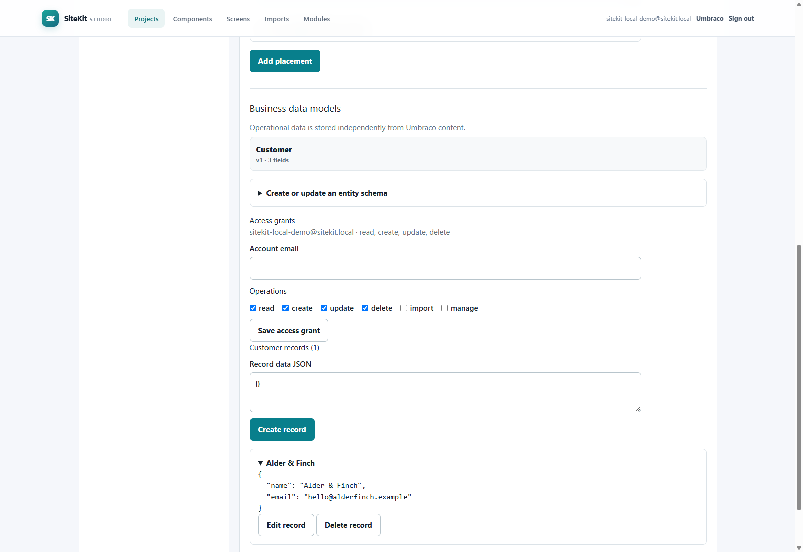

# SiteKit runtime screenshots

These captures come from local Docker and independently generated .NET
applications. They demonstrate working project output; they are **not** a
hosted SiteKit URL. The CRM uses its generated SQLite store and a local test
access token. The Studio captures show a signed-in local SiteKit test account
and live project/component registries. No fixture mockups are included.

## Live Component Studio

The component was authored through the visual editor during a live Docker
session. Its persisted definition has three typed properties (text, text, and
link) and a composed stack layout with heading, text, and button primitives.
The registry API returned the saved version on a subsequent Studio load.

## One component, two project placements

| Northstar Advisory | Modern Atelier |
| --- | --- |
|  |  |

Both project screens come from the running Umbraco host. The projects reference
the same `northstar-editorial-hero` version, while their placement records hold
different data and independent appearance overrides. The placement and preview
API endpoints returned HTTP 200 for each project. The UI contrast fix ensures
the descriptive text inherits the configured placement color.

## Live business record and permission grant

The authenticated Studio session created a Customer entity record in the
Umbraco host's SQL Server store. Its `Alder & Finch` data and the explicit
read/create/update/delete grant for the local test principal remained available
after restarting the application container. A separate CRUD probe received
201 on create, 200 on update/read, and 204 on soft delete; reading the deleted
record then returned 404. Removing the read grant produced 403, and restoring
it returned 200. SQL inspection confirmed one active demonstration record and
one soft-deleted verification record. This exercises the current host SQL
record store; the independently generated CRM shown below uses SQLite.

## Generated CRM

The application was running locally with three persisted customers and three
opportunities. The screenshot shows its overview, customer table, and pipeline
board. Browser console check reported no errors. The integration test separately
verifies permission denial, CRUD, relationship validation, delete protection,
and data retention through restart.

## Shared component across two generated websites

These two running .NET sites share one registered `shared-banner` component
definition. Northstar Advisory uses blue styling and strategy copy; Lumen House
uses a warm palette, serif typography, and hospitality copy. Both sites were
built and served locally from generated project output. Each screenshot shows
the shared component receiving independent project data and appearance.

## Live Umbraco availability check

Captured from the running Umbraco container at
`http://localhost:44372/umbraco/login`. This verifies the real Umbraco login
form is served by Docker. It is separate from the SiteKit Studio session shown
above. The default Compose stack is HTTP only; with the trusted HTTPS overlay
active, requests to port 44372 redirect to HTTPS on port 44373. OpenIddict
metadata returns HTTP 200 over HTTPS and rejects HTTP requests. SQL Server was
healthy during the Studio smoke check.
