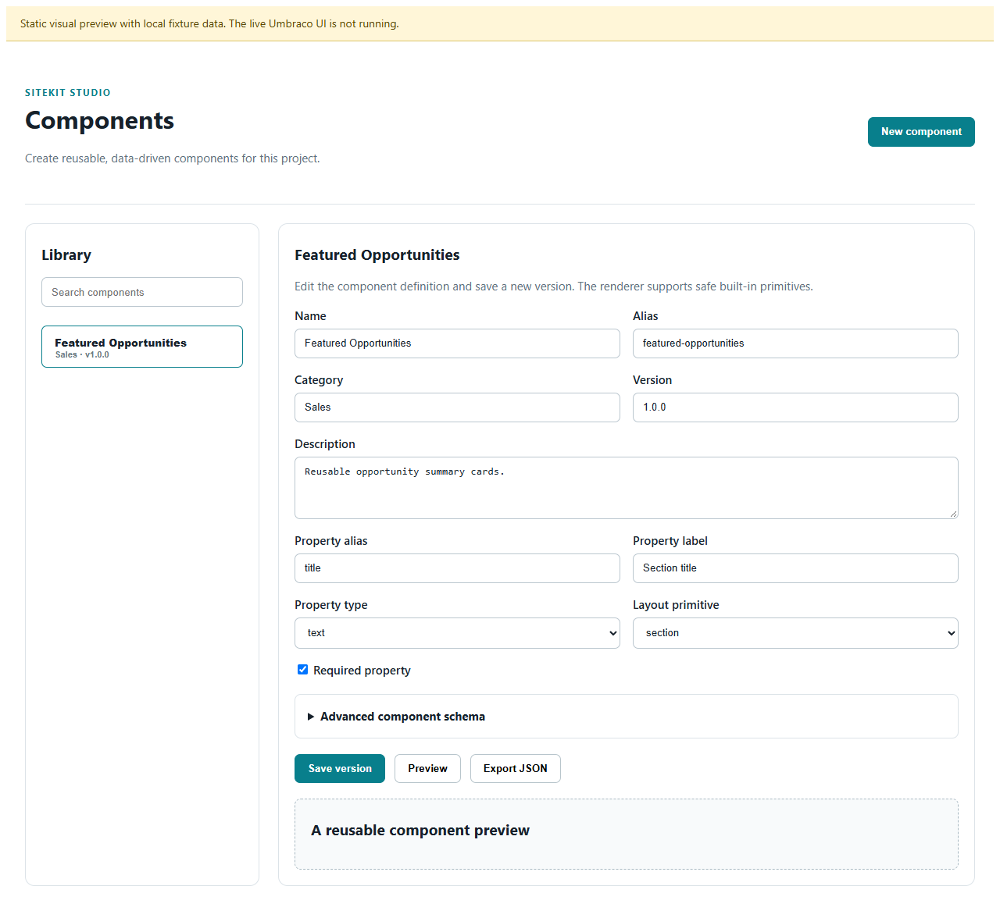
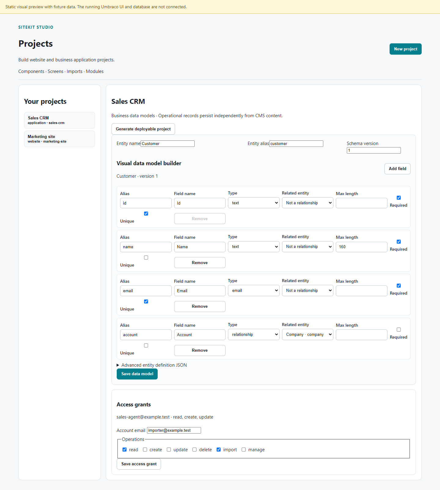
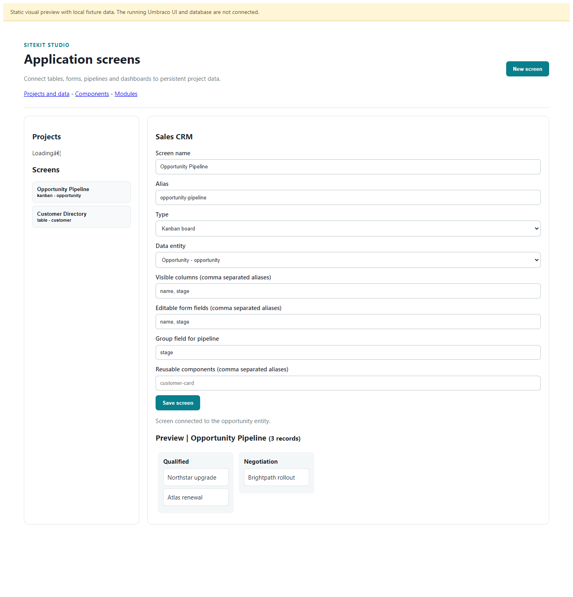
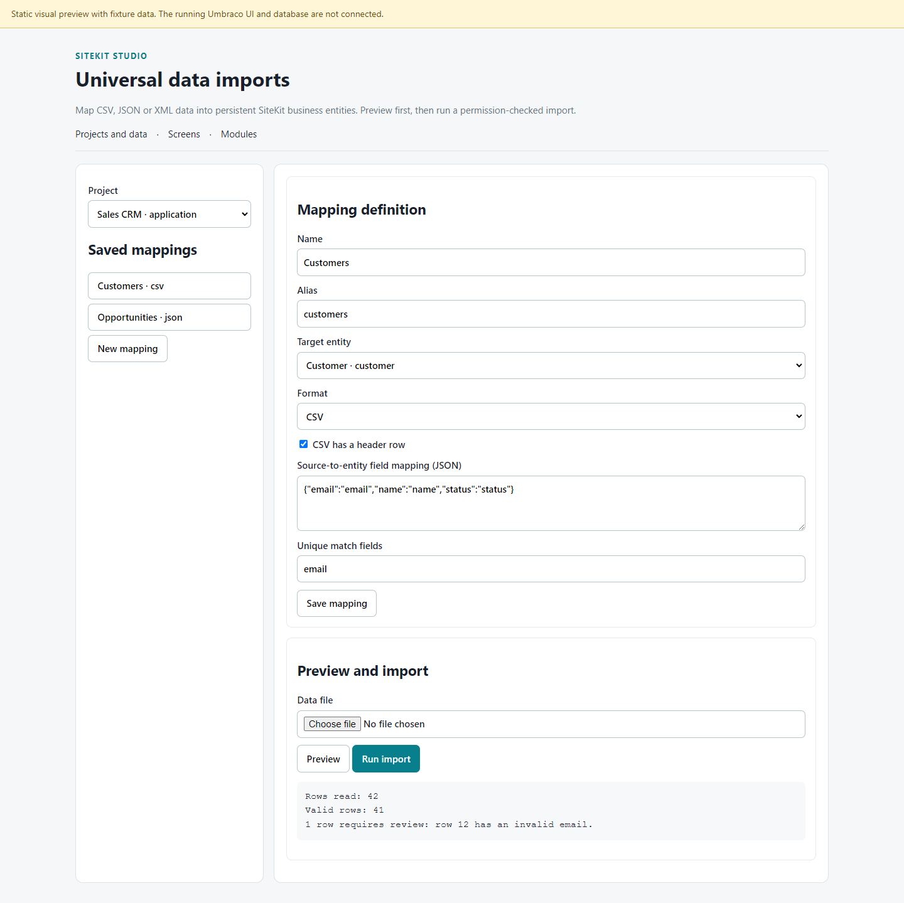
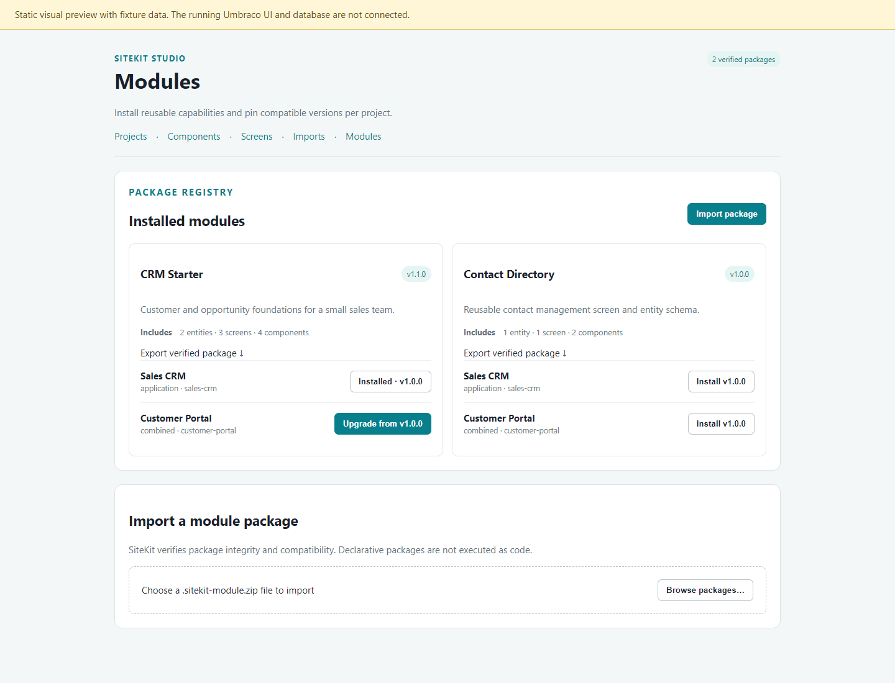
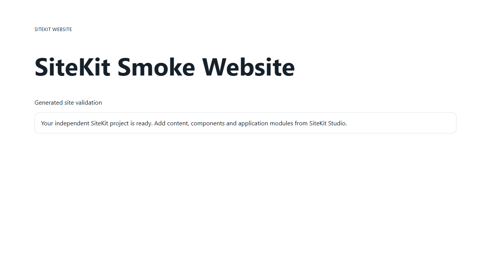

# SiteKit Studio and generated project screenshots

The Component Studio and Projects Studio captures are static Playwright previews backed by local fixture data. They are **not** screenshots from the running Umbraco backoffice. This machine has no SQL Server service and its Docker Desktop Linux engine is unavailable. Their banner marks this limitation.

## Component Studio

This shows the component catalogue, multi-property visual schema builder,
composed/reorderable layout editor, advanced schema controls and preview. It is
a static fixture preview, not a running Umbraco screen.

## Projects Studio

This shows the project list, visual entity identity/field editor, field types,
relationship targets, validation and explicit import permissions. The live UI
and operational database are not connected; the screenshot uses fixture data.

## Application Screens Studio

This static Playwright capture shows a project-bound opportunity pipeline screen
definition, entity and field bindings, and a sample kanban preview. The live
screen definition API and MCP create/list/validation tools were smoke-tested,
and the view now includes record editing controls wired to permission-checked
CRUD APIs. The screenshot uses fixture data and does not imply a live
backoffice or database connection; those new controls still need runtime
verification against Umbraco and SQL.

## Universal Imports Studio

This fixture screenshot shows project/entity mapping setup, CSV/JSON/XML
selection, a saved customers mapping and a sample row-validation preview. The
authenticated API and mapping controls compile, and core parser/import tests
pass; the screenshot is not connected to a running Umbraco instance.

## Module Studio

This fixture shows verified packages, per-project installed version pins,
explicit upgrade controls and package import/export. The UI wiring compiles and
module version/upgrade rules are covered by core contract tests; the screenshot
is not connected to a running Umbraco instance.

## Generated website runtime

This screenshot is from a running independently generated .NET website. The generated site built with .NET 10; `/health` returned `{"status":"healthy"}` and `/` returned HTTP 200. This is runtime evidence for project generation, not live Umbraco, SQL CRUD or authorization coverage.

## Generated application runtime

This capture is from a running generated application project. Its screen
definition loaded from the exported manifest, the token-gated screen API
returned the Customers table and create form, and the browser reported no
JavaScript errors. The integration test also built the emitted project and
verified unauthorized access, create/update/read/delete operations and record
retention across an application restart. Storage is local JSON and access uses
one administrator bearer token; this is not evidence for production RBAC or SQL.

Reproducible Studio fixture HTML pages are included beside the screenshots.
