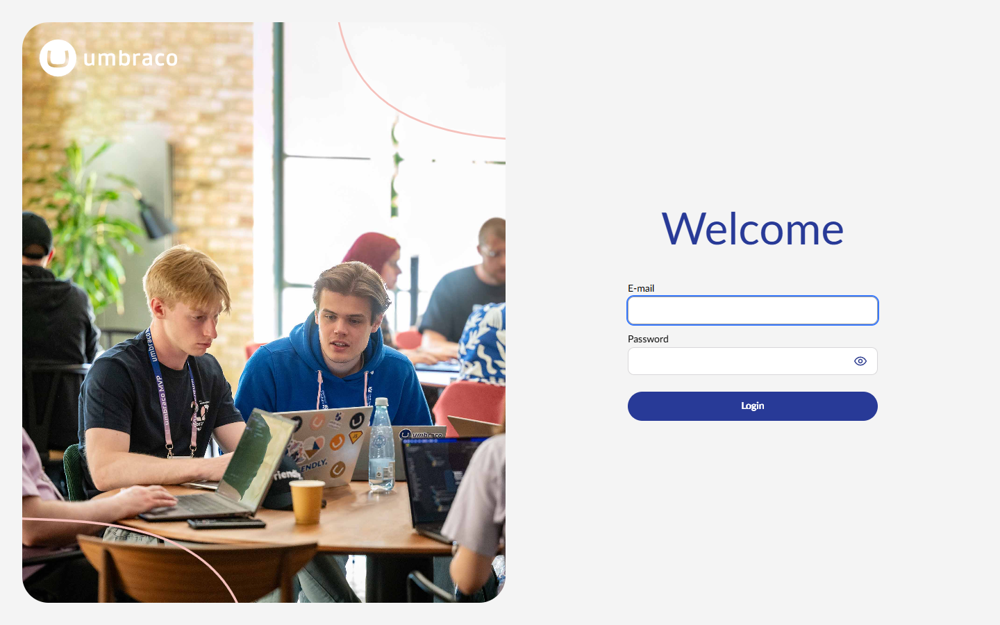

# SiteKit runtime screenshots

These showcase captures come from independently generated .NET applications
running locally. They demonstrate working project output; they are **not** a
hosted SiteKit URL. The CRM uses its generated SQLite store and a local test
access token. No fixture mockups are included in this gallery.

## Generated CRM

The application was running locally with three persisted customers and three
opportunities. The screenshot shows its overview, customer table, and pipeline
board. Browser console check reported no errors. The integration test separately
verifies permission denial, CRUD, relationship validation, delete protection,
and data retention through restart.

## Shared component across two generated websites

These two running .NET sites share one registered `shared-banner` component
definition. Northstar Advisory uses blue styling and strategy copy; Lumen House
uses a warm palette, serif typography, and hospitality copy. Both sites were
built and served locally from generated project output. Each screenshot shows
the shared component receiving independent project data and appearance.

## Live Umbraco availability check

Captured from the running Umbraco container at
`http://localhost:44372/umbraco/login`. This verifies the real Umbraco login
form is served by Docker; it does not show an authenticated SiteKit Studio
view. The local Compose port is HTTP only, and OpenIddict rejects the sign-in
authorization request until HTTPS is configured with a trusted local
certificate. SQL Server was healthy and the booking-engine `/health` endpoint
returned HTTP 200 during the same smoke check.
